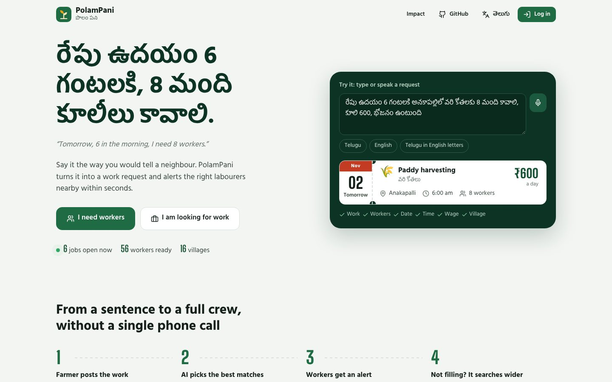
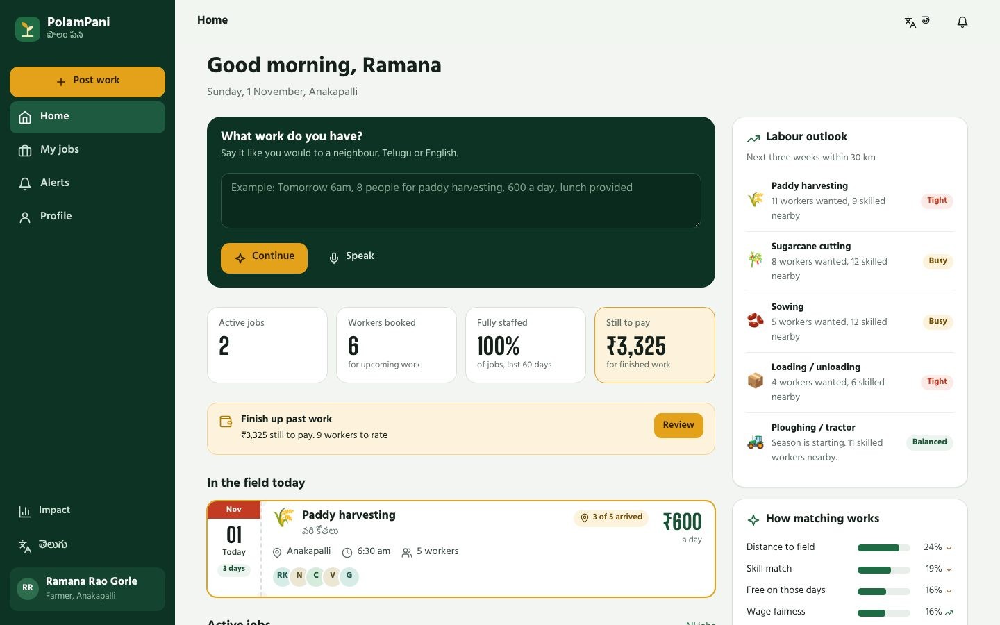
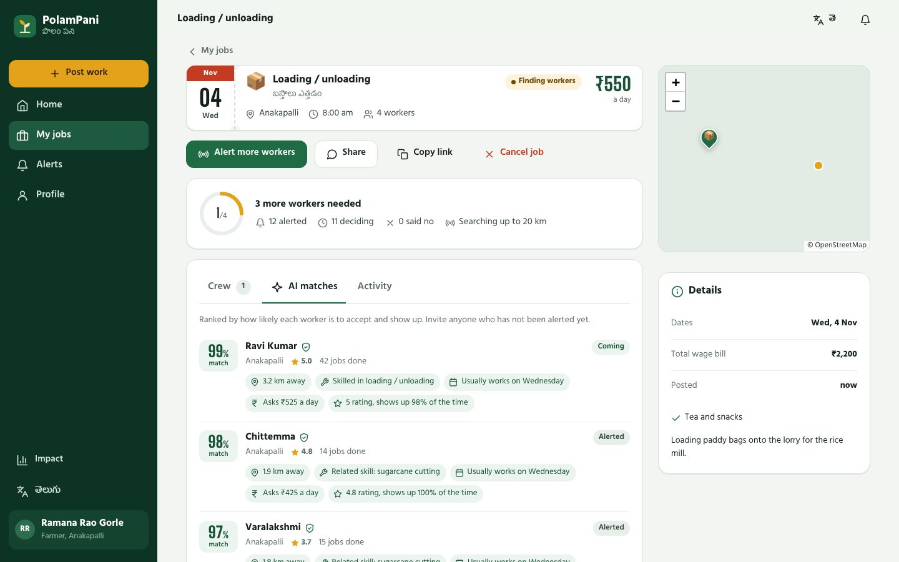
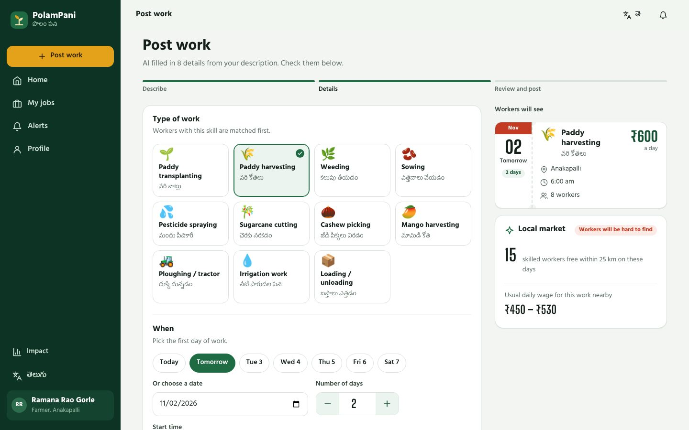
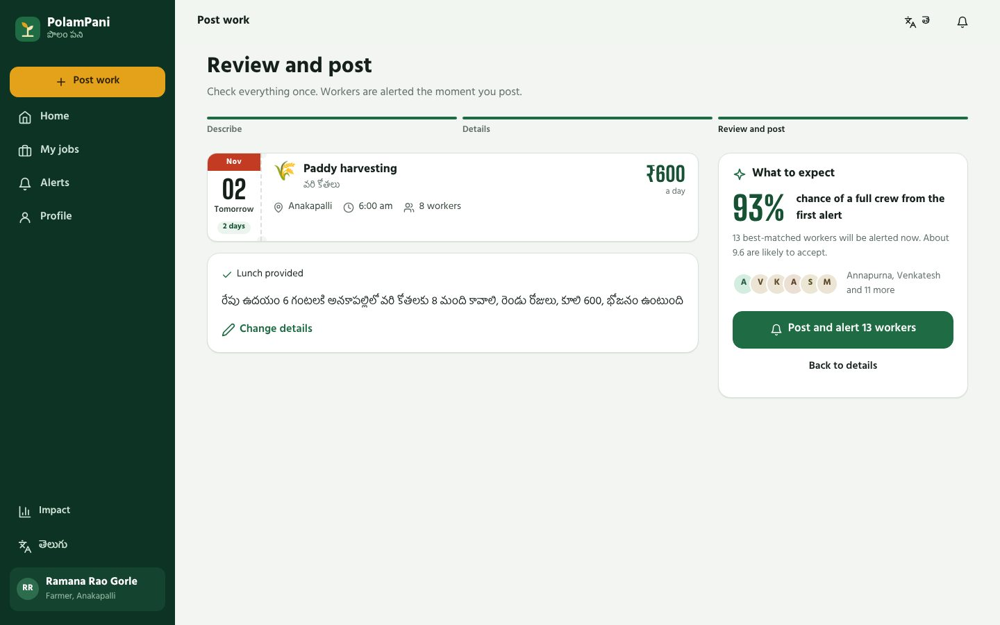
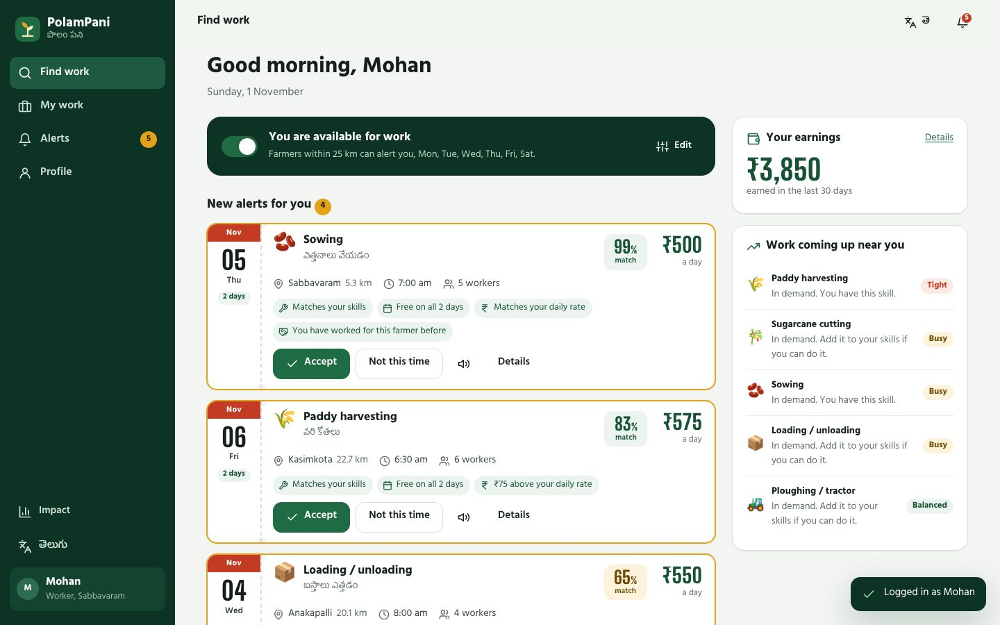
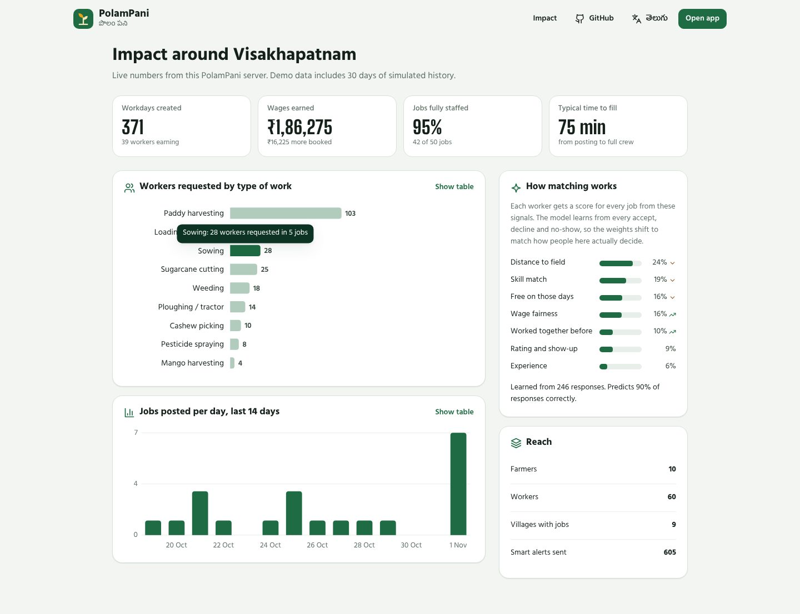
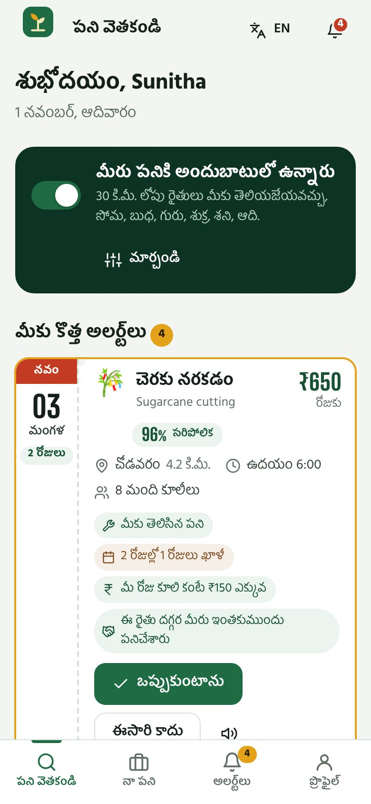
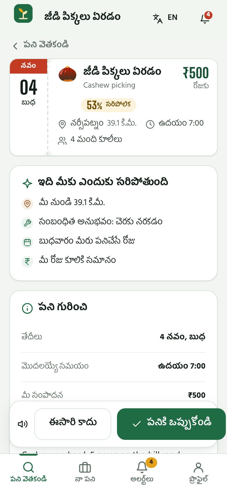

# PolamPani · పొలం పని

**Farm work, filled on time.** PolamPani connects farmers with agricultural labourers nearby. A farmer says what they need the way they would tell a neighbour, in Telugu or English, by voice or text. Open-source AI turns that into a work request, alerts the workers most likely to say yes, explains every match, and keeps widening the search until the crew is full.

Built for **Hacktoberfest Hack Day × AI for Vizag**, competing for **Best Open Source AI Project**.

[](https://render.com/deploy?repo=https://github.com/Uma-mahesh69/polampani) &nbsp; `npm install && npm start` runs it locally in under a minute.



## The problem

Transplanting and harvest windows are short. A few days' delay can cost a farmer a large share of the crop, yet labour is still found by phoning middlemen and visiting nearby villages. Labourers, meanwhile, miss paid work a few kilometres away. Nothing connects the two in real time, and most tools that try assume English literacy and a good connection.

## What it does

| Farmers | Labourers |
|---|---|
| Post work by **speaking or typing in Telugu or English**. AI fills in work type, workers, dates, time, wage, village, lunch and transport | **Instant alerts** for work that fits their skills, location and working days, **read aloud** in Telugu |
| **Fair-wage guidance** and how many skilled workers are free on those days | A personal feed **ranked by AI**, with plain reasons ("₹100 above your daily rate", "Free on both days") |
| A **forecast before posting**: the chance of a full crew from the first alert | Accept in one tap; the farmer's phone number, WhatsApp and directions unlock |
| Live progress, then **attendance check-in** on the day | **I've reached the field** check-in |
| Unfilled jobs and cancellations **re-alert automatically over a wider radius** | Double-booking protection across multi-day jobs |
| Mark who came, **rate** workers, **pay by cash or UPI** with a record | **Earnings** and payment status; rate farmers too |
| Labour outlook for the next 3 weeks from a **crop calendar** + posted demand | See which skills are in demand nearby |

Plus: phone + OTP login, a public **Impact** page, shareable job links for WhatsApp groups, SMS gateway hook for basic phones, installable PWA that works on flaky connections, full Telugu interface.

| | |
|---|---|
|  |  |
|  |  |
|  |  |

<p align="center"> &nbsp; </p>

## How the AI works

Everything runs on your own server. No paid AI API, and no farmer or worker data leaves the machine.

### 1. Explainable matching that learns (`src/matcher.js`)

Every worker–job pair gets seven interpretable features:

| Feature | Signal |
|---|---|
| Distance | `exp(-km / 10)`, Haversine from the worker's home to the field |
| Skill | 1.0 exact, 0.55 related (e.g. weeding ↔ transplanting), 0.15 new work |
| Availability | Share of the job's days that are the worker's usual working days |
| Wage fairness | Offered wage vs. the worker's daily rate |
| Reliability | Rating blended with show-up rate (completed vs. no-shows) |
| Experience | Log-scaled jobs completed |
| Rapport | Has worked for this farmer before, and was rated well |

An **online logistic-regression model** turns them into *P(accepts and shows up)*. It starts from expert priors and takes one SGD step on every **accept (1), decline (0) and no-show (0)**, so the ranking adapts to how people in each area actually decide. The Impact page shows the live weights, how they moved from the priors, and prediction accuracy. Every score ships with **structured reasons** that the UI renders in Telugu or English, for farmers and workers alike.

### 2. Dispatch, fill forecast and auto-escalation (`src/jobs.js`)

- Posting alerts the top `max(4, spots × 3)` candidates in range.
- Before posting, a **Poisson-binomial forecast** over those workers' probabilities gives the chance of a full crew from the first alert.
- Each later round widens every worker's travel radius (`1× → 1.6× → 2.5× → 4×`). Rounds trigger when a job is still open after `ESCALATE_AFTER_MIN`, when declines leave fewer people deciding than open spots, or when a confirmed worker cancels.

### 3. Multilingual job understanding (`src/nlp.js`)

Understands **any Indian language** — Telugu, Hindi, Tamil, Kannada, Malayalam, Bengali, Marathi, Gujarati, Odia, Punjabi, Assamese, and English — in native script or romanised transliteration:

```
రేపు ఉదయం 6 గంటలకి అనకాపల్లిలో వరి కోతలకు 8 మంది కావాలి, రెండు రోజులు, కూలి 600, భోజనం ఉంటుంది
நாளை காலை 6 மணிக்கு நடவு வேலைக்கு 8 ஆட்கள் வேணும், கூலி 600, சாப்பாடு உண்டு
kal subah 6 baje dhan katai ke liye 8 majdoor chahiye, 550 rupaye roz
Need 5 people for sugarcane cutting in Chodavaram on Saturday for 2 days, 650 per day
```

It extracts the work type, workers, wage, date, start time, number of days, village (with coordinates) and lunch, tea, transport or tools. Connect **Google AI Studio (Gemini API free tier)** via `GEMINI_API_KEY` for state-of-the-art multilingual comprehension across all Indian languages. Alternatively, set `LLM_BASE_URL` to any OpenAI-compatible server such as [Ollama](https://ollama.com). An offline multilingual rules engine is built in as an instant fallback.

### 4. Decision support (`src/insights.js`)

Fair-wage range and supply from skilled workers within 25 km, a labour outlook from a coastal-Andhra **crop calendar** plus posted demand, and weather on the work dates from Open-Meteo (free, no key) with advice such as "Heavy rain likely. Consider moving the date."

## Quick start

Requires **Node.js 22.13+** (it uses the built-in `node:sqlite`, so there's no native build step).

```bash
npm install
npm start
```

Open http://localhost:3000. Demo data is seeded on first start: 10 farmers, 60 labourers around Visakhapatnam, live jobs in every state, and 30 days of **simulated** history. The matching model is trained on simulated responses so the learning loop is visible from the start; in production the same loop runs on real responses.

```bash
npm test        # 13 tests: language parsing, matching, and the full API lifecycle
npm run reset   # wipe the database and reseed (stop the server first)
npm run dev     # restart on file changes
```

**Before a live demo:** stop the server, run `npm run reset`, then `npm start`. Seeded jobs are dated relative to the day you seed, so this gives you a job running *today* (with check-ins), jobs this week, and fresh alerts.

### Deploy

- **Render (one click):** use the button above. `render.yaml` sets Node 22, Indian time, a generated session secret and proxy-aware rate limits. The free plan sleeps when idle (the first visit takes about a minute) and its disk is temporary, so demo data reseeds on each restart.
- **Docker:**

  ```bash
  docker build -t polampani .
  docker run -p 3000:3000 -v polampani-data:/data polampani
  ```
- **Any Node 22 host:** `npm ci --omit=dev && npm start`. Behind a reverse proxy, set `TRUST_PROXY=1`.

## Quality

| Check | Result |
|---|---|
| Unit and API tests (`npm test`) | 13 / 13 passing: parser, matcher, full job lifecycle, permissions, validation |
| Browser end-to-end (`npm run test:e2e`) | 52 / 52 passing, no console or server errors: signup by OTP, posting from Telugu text, **live alert to a second user**, accept, invite, cancel, check-in, attendance, rating, payment, profile, language switch, and every page at phone width in English and Telugu |
| Lighthouse, mobile on simulated slow 4G | Landing **98** performance, **100** accessibility, **100** best practices, **100** SEO |

## Troubleshooting

| Symptom | Fix |
|---|---|
| `PolamPani needs Node.js 22.13 or newer` | Install the current LTS from nodejs.org |
| `EADDRINUSE` | Another app uses port 3000: `PORT=3001 npm start` (Windows PowerShell: `$env:PORT=3001; npm start`) |
| Map area is blank | Map tiles come from OpenStreetMap and need internet. Everything else works offline |
| Today's job is in the past | Demo data is from an earlier day: stop the server, `npm run reset`, `npm start` |
| Voice input does nothing | Speech recognition needs Chrome (desktop or Android) and microphone permission |

## Demo script (2 minutes)

1. Open the landing page. Type or speak in the **Try it** box and watch the chit fill in.
2. Open two windows. In one, log in as a **farmer** from *Explore with a demo account*; in the other, a **worker**. Or log in with any phone number: in demo mode the OTP is shown on screen.
3. Farmer: **Post work**, then speak or type a request in Telugu. Review the AI-filled details, the fair-wage hint and the **chance of a full crew**, then post.
4. Worker window: the alert arrives live with a sound. Tap the speaker icon to **hear it in Telugu**, then **Accept**. The farmer's progress ring updates instantly.
5. Farmer: open the job to see **AI matches** with reasons, invite someone, or **Alert more workers** to widen the radius.
6. On a job running today: check-in status, **Mark work complete** with attendance, then rate and pay by cash or UPI.
7. Open **Impact** for platform metrics and the model's learned weights.

## Configuration

See `.env.example`. Everything is optional.

| Variable | Purpose | Default |
|---|---|---|
| `PORT` | HTTP port | `3000` |
| `DB_PATH` | SQLite file | `data/polampani.db` |
| `DEMO_MODE` | Demo accounts, OTP shown in the response. **Set `false` in production** | `true` |
| `SESSION_SECRET` | Token signing secret (auto-generated and stored if unset) | |
| `ESCALATE_AFTER_MIN` | Minutes before an open job is re-alerted wider | `10` |
| `LLM_BASE_URL`, `LLM_MODEL`, `LLM_API_KEY` | Optional open-weights LLM for parsing | off, `llama3.2` |
| `SMS_WEBHOOK_URL` | Receives `{to, name, message}` for every alert and login code | off |
| `WEATHER` | Open-Meteo forecasts | `true` |
| `TRUST_PROXY` | Set behind a hosting proxy so rate limits see real client IPs | `loopback` |
| `TZ` | Timezone for "today" and job dates | `Asia/Kolkata` |

## Pitch notes

See [docs/PITCH.md](docs/PITCH.md) for a 2-minute pitch and answers to likely judge questions.

## Architecture

```
server.js            Express app: security headers, static + vendor assets, API, SPA fallback, escalation timer
src/api.js           REST API with auth, role checks, ownership checks and rate limiting
src/auth.js          Phone + OTP login, HMAC-signed session tokens
src/matcher.js       Features, logistic model, online learning, ranking, explanations, fill forecast
src/jobs.js          Job lifecycle: dispatch, invite, accept, decline, withdraw, cancel, check-in, complete, rate, pay
src/insights.js      Fair wage, crop-season outlook, impact metrics, weather
src/nlp.js           Multilingual parser (+ optional open LLM)
src/notifier.js      Server-Sent Events push + SMS webhook
src/messages.js      Notification text in Telugu and English (SMS)
src/catalog.js       Work types, facilities, crop calendar, villages, geo/date helpers
src/db.js            SQLite schema and migrations (node:sqlite)
src/runtime.js       Node version check, .env loading, IST timezone
public/              No-build ES-module frontend, PWA service worker, self-hosted fonts and Leaflet
test/                node:test suites; test/e2e/ has the Playwright browser suite
```

The frontend uses no framework and has no build step. Typefaces are *Hind Guntur* (Telugu and Latin; named after the Andhra district) and *Big Shoulders Display* for figures. Each job is drawn as a **work chit** with a tear-off-calendar date block.

## API

All endpoints are under `/api`. Authenticated calls send `Authorization: Bearer <token>`.

| Method | Path | Who | Purpose |
|---|---|---|---|
| POST | `/auth/otp`, `/auth/verify`, `/auth/signup` | anyone | Phone login and onboarding |
| GET, PATCH | `/me` | user | Profile, availability, skills, UPI |
| POST | `/ai/parse` | anyone | Text → structured job |
| GET | `/ai/insight`, `/ai/season`, `/ai/model`, `/weather` | anyone | Decision support and model state |
| POST | `/jobs/preview`, `/jobs` | farmer | Forecast, then post and dispatch |
| GET | `/jobs/mine`, `/jobs/:id`, `/jobs/:id/matches` | farmer | Jobs, crew, timeline, ranked candidates |
| POST | `/jobs/:id/{dispatch,invite,cancel,complete}` | farmer | Lifecycle |
| POST | `/assignments/:id/{review,paid}` | farmer | Rate and record payment |
| GET | `/feed`, `/work` | worker | Ranked feed (filters: `work_type`, `max_km`, `min_wage`, `sort`) and earnings |
| POST | `/jobs/:id/{accept,decline,withdraw,checkin}` | worker | Respond and check in |
| GET | `/notifications`, `/stream` | user | Notifications and live SSE |
| GET | `/impact`, `/stats` | anyone | Public metrics |

## Roadmap

- IVR / missed-call flow and SMS replies (`1` to accept) for workers without smartphones
- Crew bookings, so a *mestri* can accept for a team
- More districts: village lists and crop calendars for all of Andhra Pradesh and Telangana
- UPI payment confirmation through a payment gateway

## Contributing

Translations, village lists and crop calendars are the easiest places to start. See [CONTRIBUTING.md](CONTRIBUTING.md).

## License

[MIT](LICENSE)
